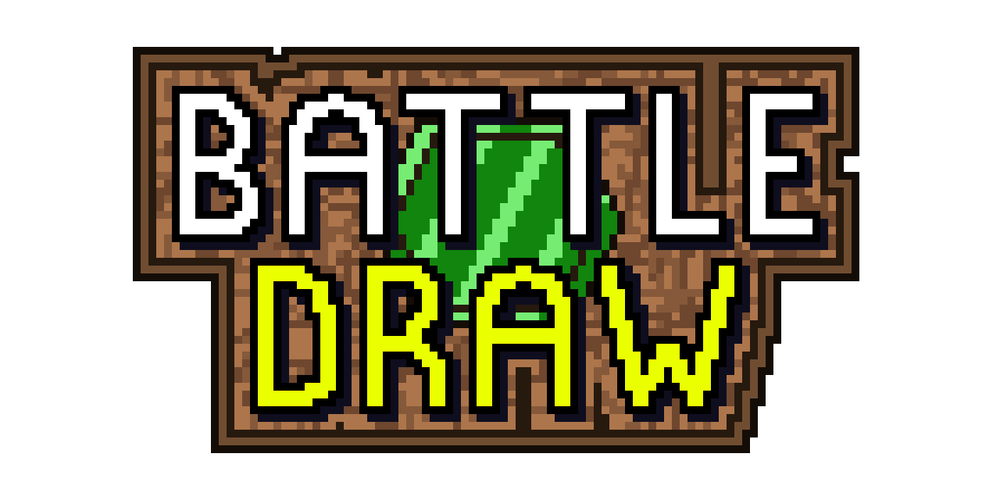
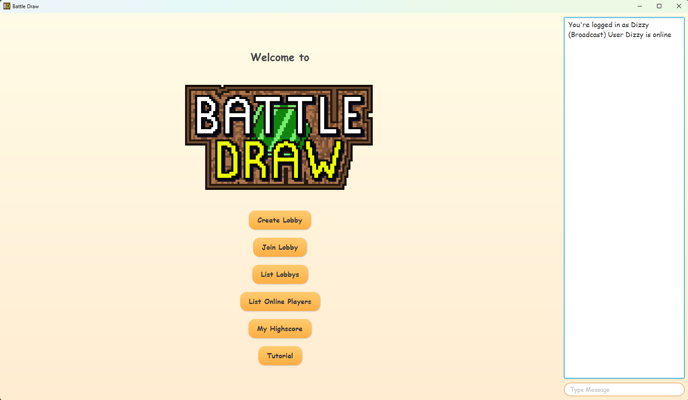

# Manual Battle Draw
### How to start a game:

To start a game, you must do the following things:

- If not yet done, install Java (21 or newer)
- Start a server
- Start clients (in the same network as the server)
- Join the same lobby, decide on what settings to use, and start the game.
### Steps to Run:

1. Open a terminal or command prompt.
2. Navigate to the project directory.
3. Build the JAR file with Gradle:

   ```bash
   ./gradlew build-cs108
   ```

4. Change to the `build/libs` directory:

   ```bash
   cd build/libs
   ```

5. Start the server (once):

   ```bash
   java -jar Battle_Draw.jar server <port>
   ```

   **Example:**

   ```bash
   java -jar Battle_Draw.jar server 8989
   ```

6. Start a new player instance:

   ```bash
   java -jar Battle_Draw.jar client <ip>:<port> <username>
   ```

   **Example:**

   ```bash
   java -jar Battle_Draw.jar client localhost:8989 JohnDoe
   ```

---

## 👤 Account

After successfully connecting to the server with a username, a window will appear.

- You can **log in** if you already have an account or **create a new account**.
- If the username is already taken, a slightly altered one will be automatically generated for you.

---

## 🏠 Lobby

- You can **create a new lobby** and become the host. The lobby name will automatically be set as `Lobby_of_Username`. This way, other players can easily identify the host.
- If you don't want to create a new lobby, you can **join an existing lobby**. Simply click the **"List Lobby's"** button to see all currently open lobbies. Choose one from the list to join the game. You can do this by pressing the **"join lobby"** button and entering the username of the lobby you want to join.
- Once you're in a lobby, the host has the control to **start the game**. Make sure everyone is ready before proceeding!

### Host Controls:
- The host can select the **number of rounds** to be played by choosing from a dropdown menu.
- The host can also set the **time limit per round** using another dropdown menu.
- After configuring the settings and ensuring all players are ready, the host can click the **"Start"** button to begin the game.

Additionally, you can view the **list of online players** by clicking the **"List Online Players"** button, allowing you to see who’s currently connected.  
If you wish to change your display name, simply use the **"Change Username"** button.  
To track your progress and compare with others, check your **highscore** by clicking the **"My Highscore"** button.

---

## 🎮 Game

- Above the drawing area, you will see the **theme** and the **remaining time** displayed.
- You have access to **various colors and brush sizes** to create your drawing. You can choose from a predefined color palette or create a **custom color** using the HSB, RGB, or Web format. Additionally, you can adjust **opacity** and **brightness** for finer control over your artwork.
- The game round ends **automatically when the timer expires**.

  

### Rating Phase:
- After the drawing phase, the game moves to the **rating page**:  
  → Here, you rate other players' drawings on a scale from **1 to 5**.
- It is crucial to **submit your rating within the given time**. If you do not rate a drawing before the timer runs out, the game will **automatically assign a rating of 5** to that drawing.
- The rating phase ends automatically when the timer expires.

### Game Flow:
- Once the rating phase ends, the next drawing will be displayed.
- At the end of all rounds, the player with the **highest total rating** wins the game.
- After the game concludes, you can either **play another round** or **return to the start screen**.


---

## 💬 Important Commands (Chat Commands)

```
/whisper <name> <Message>
```
→ Send a private message to a player.  
Example: `/whisper JohnDoe Hey, nice drawing!`